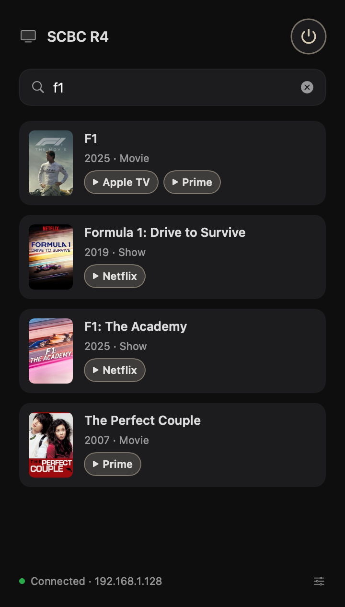
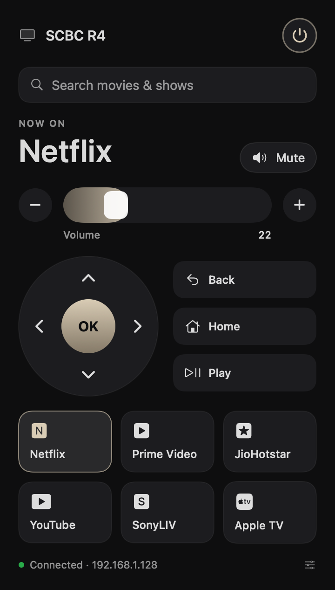
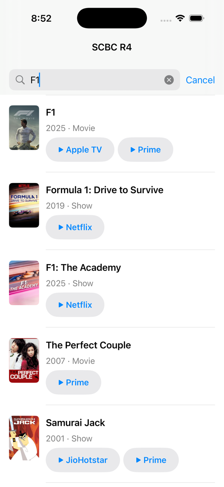

# Android TV remote: iPhone app, Mac menu-bar widget and cross-app search

Search for a title once, see which of your streaming apps has it, and open it on the TV.
Netflix, Prime Video, JioHotstar, SonyLIV, Apple TV and YouTube all work, with no "open app → search
→ type with the D-pad" dance.

It talks to the TV directly using **Google's Android TV Remote protocol v2**, the same protocol the
Google TV app uses. It's pure Swift with zero dependencies: protobuf is hand-rolled, the TLS client
certificate is generated on the device, and pairing uses the 6-character code the TV shows.

<p align="center">
  
  &nbsp;
  
  &nbsp;
  
</p>

## What's in here

| | |
|---|---|
| **`ATVRemoteKit`** | The protocol, as a Swift package (iOS 16+ / macOS 14+). It covers pairing (port 6467), the remote (6466), Bonjour discovery and JustWatch search. |
| **iPhone app** (`App/TVRemote`) | **Search across apps**: poster/title/year rows; tap an app to open the title on the TV. Plus the remote: D-pad, OK/Back/Home, volume, play/pause. |
| **Mac menu-bar widget** (`Sources/TVRemoteBar`) | A dark popover remote with **search across apps**, keyboard control (arrows, Return, Esc) and a ⌃⌥T hotkey. It builds with just the Command Line Tools, no Xcode. |
| **`atvctl`** | A CLI over the same kit: `pair`, `key`, `launch`, `discover`. Handy for poking at a TV. |

Tested on an Acer R4 (Android TV 14) in India. Any Android/Google TV with the "Android TV Remote
Service" should work.

## How search works
[JustWatch's](https://www.justwatch.com) GraphQL API returns, for each title, the services that carry
it, with web links. The widget keeps only links that the TV apps' intent filters actually claim. It
then sends them to the TV as a `RemoteAppLinkLaunchRequest`, and the TV fires `ACTION_VIEW` on the
URL. This is JustWatch's **unofficial** public API, so it's fine for personal use and may change
without notice.

Per-app findings live in [`docs/DEEPLINKS.md`](docs/DEEPLINKS.md). The fun ones:
- **Netflix ignores title links unless they carry `source=30`.** Normally that's an intent extra,
  but the remote protocol can only send a bare URL, so it goes in the query string:
  `https://www.netflix.com/title/<id>?source=30`.
- **Prime Video** only claims `app.primevideo.com/detail?gti=…`, not `www.primevideo.com`.
- **JioHotstar** claims `www.hotstar.com`, not `jiohotstar.com`.
- **Profile pickers** ("Who's watching?") can swallow the link on a cold start, so after OK both
  apps re-send it.
- **F1 TV** declares no deep links and can't be opened over this protocol at all.

## Protocol gotchas (things the docs don't tell you)
- **The TV doesn't strictly verify the pairing secret against the presented certificate.** If TLS
  presents a different identity than the one you hashed, pairing still "succeeds", but port 6466 then
  rejects you with `bad certificate` (TV log: `Incoming connection from unknown device`). On macOS, the
  file-based keychain ignores cert labels, and `SecItemDelete` removes only the first match, so stale
  identities got mixed up. Fix: take the certificate *from the SecIdentity* you hand to TLS.
- **The TV dedupes paired certs by subject**, so every client identity gets a unique CN.
- **Keys sent right after `remote_start` are silently dropped** (lost at 0 ms, delivered at 300 ms or
  later), so `connect()` settles for 500 ms.
- The client cert needs `basicConstraints CA:TRUE` and a SAN, the same as androidtvremote2's.
- Some TVs don't advertise `_androidtvremote2._tcp`, so discovery also browses `_googlecast._tcp`.
- There is no "set volume to N", only volume key steps. The widget's slider sends the difference.

## Build it

**Mac widget** (Command Line Tools are enough):
```bash
scripts/build-mac-widget.sh      # installs ~/Applications/TV Remote.app and opens it
```
Open it from the menu-bar TV icon or with **⌃⌥T**. Pair once with the code shown on the TV.

**iPhone app** (Xcode 26+):
```bash
cp Config/Signing.xcconfig Config/Signing.local.xcconfig   # then set your DEVELOPMENT_TEAM + BUNDLE_ID_PREFIX
xcodegen generate && open TVRemote.xcodeproj
```
A free Apple ID works: use your "Personal Team". With free signing, the app must be re-installed
every 7 days. On first launch, trust the profile on the phone (Settings → General → VPN & Device
Management) and allow Local Network access.

**CLI:**
```bash
swift build
.build/debug/atvctl discover
.build/debug/atvctl pair <tv-ip>                 # type the code shown on the TV
.build/debug/atvctl key <tv-ip> home right ok
.build/debug/atvctl launch <tv-ip> "https://www.netflix.com/title/80057281?source=30"
```

## Credits
- Protocol message layouts come from [tronikos/androidtvremote2](https://github.com/tronikos/androidtvremote2)
  (Apache-2.0), the library behind Home Assistant's Android TV Remote integration. This is a
  from-scratch Swift implementation, not a port of its code.
- Title availability comes from [JustWatch](https://www.justwatch.com).
- Built in an afternoon with [Claude Code](https://claude.com/claude-code).

Not affiliated with Google, Netflix, Amazon, JioHotstar, Sony, Apple or JustWatch.

## License
MIT
